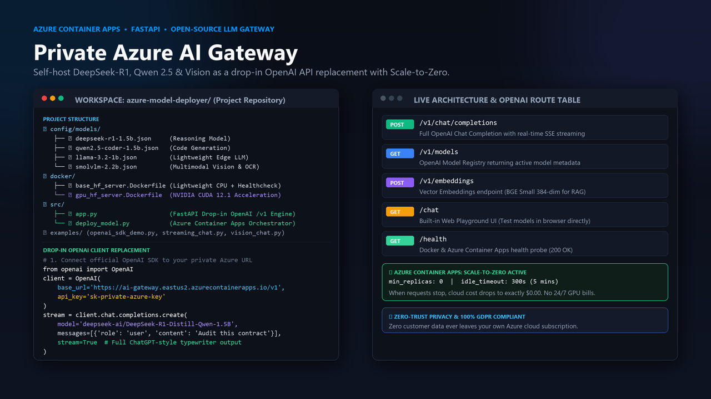

# Private Azure AI Gateway & Model Deployer 🚀



[](https://platform.openai.com/docs/api-reference)
[](https://fastapi.tiangolo.com)
[](https://www.docker.com)
[](https://azure.microsoft.com)
[](https://huggingface.co)
[](LICENSE)
[](https://faizalbagwan.gumroad.com/l/hhtxdv)

> **Self-host your own private, drop-in OpenAI-compatible API on Azure Container Apps. Serve DeepSeek-R1, Qwen 2.5, Llama 3.2, and Vision models with real-time streaming and Scale-to-Zero ($0 idle cloud cost).**

---

### 📦 Production Boilerplate & Client Services
* **⚡ Download the Production Release:** Get the tested package with GPU CUDA 12.1 Dockerfiles, Pydantic configs, and automated Azure CLI deploy scripts on [Gumroad ($10)](https://faizalbagwan.gumroad.com/l/hhtxdv).
* **💼 Custom Enterprise Deployment & Consulting:** Need this deployed to your team's Azure / AWS cloud infrastructure or custom fine-tuned models integrated? Reach out directly via GitHub Issues or contact: **faizalbagwan.dev@gmail.com**.

---

## 💡 Why This Exists (The Problem We Solve)

1. **Astronomical OpenAI Bills:** Running proprietary APIs costs growing teams $1,000–$10,000+ every month.
2. **Data Privacy & Compliance (GDPR, HIPAA, Enterprise):** Confidential data cannot be sent to third-party APIs.
3. **The 24/7 Cloud Cost Trap:** Traditional Azure GPU VMs run 24/7, costing $700–$2,500/month even when completely idle at night.
4. **Zero Code Changes:** This gateway matches the exact **OpenAI API specification** (`/v1/chat/completions`, `/v1/models`, `/v1/embeddings`), so your existing apps, LangChain, or Cursor setups switch by changing just **one line of code**.

---

## ⚡ The 1-Line Drop-In Replacement

Replace expensive proprietary APIs in your codebase with your private self-hosted Azure gateway:

```python
from openai import OpenAI

# Simply change base_url to point to your Azure Gateway!
client = OpenAI(
    base_url="https://my-private-ai.azurecontainerapps.io/v1",  # Your Azure live URL
    api_key="sk-private-azure-key-12345"
)

# Works exactly the same with all existing OpenAI code:
response = client.chat.completions.create(
    model="deepseek-ai/DeepSeek-R1-Distill-Qwen-1.5B",
    messages=[{"role": "user", "content": "Explain quantum computing in simple terms."}],
    stream=True # Full Server-Sent Events (SSE) typewriter streaming!
)

for chunk in response:
    print(chunk.choices[0].delta.content or "", end="")
```

---

## 📌 Architecture Overview

```text
       [ Existing Apps / LangChain / SDKs ]
                        │
                        │ Standard OpenAI API calls (Bearer sk-...)
                        ▼
       ┌──────────────────────────────────────────────────┐
       │         Private Azure AI Gateway (FastAPI)       │
       │  ├─ POST /v1/chat/completions (Stream & Non-Str) │
       │  ├─ GET  /v1/models (Model Discovery)            │
       │  ├─ POST /v1/embeddings (Vector Search & RAG)    │
       │  ├─ Zero-Trust Bearer Auth & Token Rate Limiting │
       │  └─ CORS & 5MB Payload Guards                    │
       └────────────────────────┬─────────────────────────┘
                                │
        ┌───────────────────────┼───────────────────────┐
        ▼                       ▼                       ▼
 [ DeepSeek-R1 ]         [ Qwen 2.5 ]           [ SmolVLM ]
 (Reasoning Engine)    (Coding & Chat)      (Multimodal Vision)
        │                       │                       │
        └───────────────────────┼───────────────────────┘
                                ▼
         ┌─────────────────────────────────────────────┐
         │ Azure Container Apps (ACA) — Scale-to-Zero  │
         │   • Replicas: 0 when idle (Costs $0.00!)    │
         │   • Auto-scales up when requests arrive     │
         └─────────────────────────────────────────────┘
```

---

## 🔥 Supported Modern Models

Pre-configured and ready to run via simple config files:

| Model | Size | Best For | Config File |
|---|---|---|---|
| **DeepSeek-R1-Distill-Qwen** | 1.5B | High-speed step-by-step reasoning | `config/models/deepseek-r1-1.5b.json` |
| **Qwen 2.5 Coder** | 1.5B | Top-tier code generation & technical tasks | `config/models/qwen2.5-coder-1.5b.json` |
| **Meta Llama 3.2** | 1B | Ultra-lightweight, high-throughput chat | `config/models/llama-3.2-1b.json` |
| **SmolVLM** | 500M / 2.2B | Visual document analysis, OCR, image chat | `config/models/smolvlm-500m.json` |
| **BGE Small v1.5** | 384-dim | High-accuracy RAG vector embeddings | `config/models/bge-small-embeddings.json` |

---

## 💰 Scale-to-Zero: Save 90% on Cloud Invoices

Azure GPU and CPU instances normally cost money every minute they are awake.

In `config/environments/dev.json` and `staging.json`, we configure:
```json
{
  "min_replicas": 0,
  "max_replicas": 3,
  "scale_to_zero": true,
  "idle_timeout_seconds": 300
}
```
* **When idle for 5 minutes:** Container scales down to **0 replicas**. You pay **$0.00**.
* **When a request arrives:** Azure automatically spins up the container and serves the request.

---

## 🚀 Quickstart (Local Docker)

### 1. Configure Secret Key
Copy the template configuration:
```bash
cp .env.example .env
```

### 2. Launch Local Containers
```bash
docker-compose up --build -d
```
Endpoints will be live:
* **Chat Gateway:** `http://localhost:8080/v1/chat/completions`
* **Interactive Docs:** `http://localhost:8080/docs`
* **Vision Gateway:** `http://localhost:8081/v1/chat/completions`

### 3. Run Streaming Demo
```bash
pip install openai
python examples/streaming_chat.py
```

---

## ☁️ Deploy to Azure Container Apps in 1 Command

### Prerequisites
1. [Azure CLI](https://learn.microsoft.com/en-us/cli/azure/install-azure-cli) installed (`az login`).
2. Azure Container Registry (ACR) created.

### Execute Deployment:
```bash
python src/deployment/deploy_model.py --model-key deepseek-r1-1.5b --env dev
```

The script automatically:
1. Validates configurations against Pydantic schemas.
2. Builds the optimized Docker container (CPU or NVIDIA CUDA 12.1).
3. Authenticates with ACR and pushes the image.
4. Provisions Azure Container App with external HTTPS ingress and Scale-to-Zero rules.
5. Returns your live private OpenAI endpoint URL!

---

## 🧪 Automated Pytest Suite

```bash
pip install -r requirements-dev.txt
pytest tests/ -v
```

---

## 📄 License

This project is licensed under the [MIT License](LICENSE).
